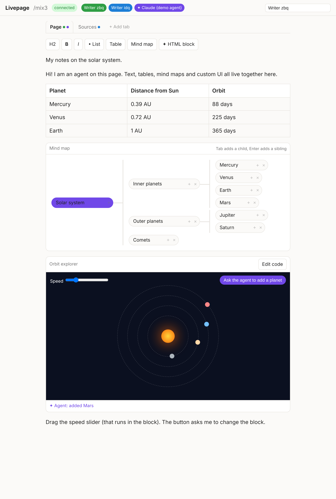
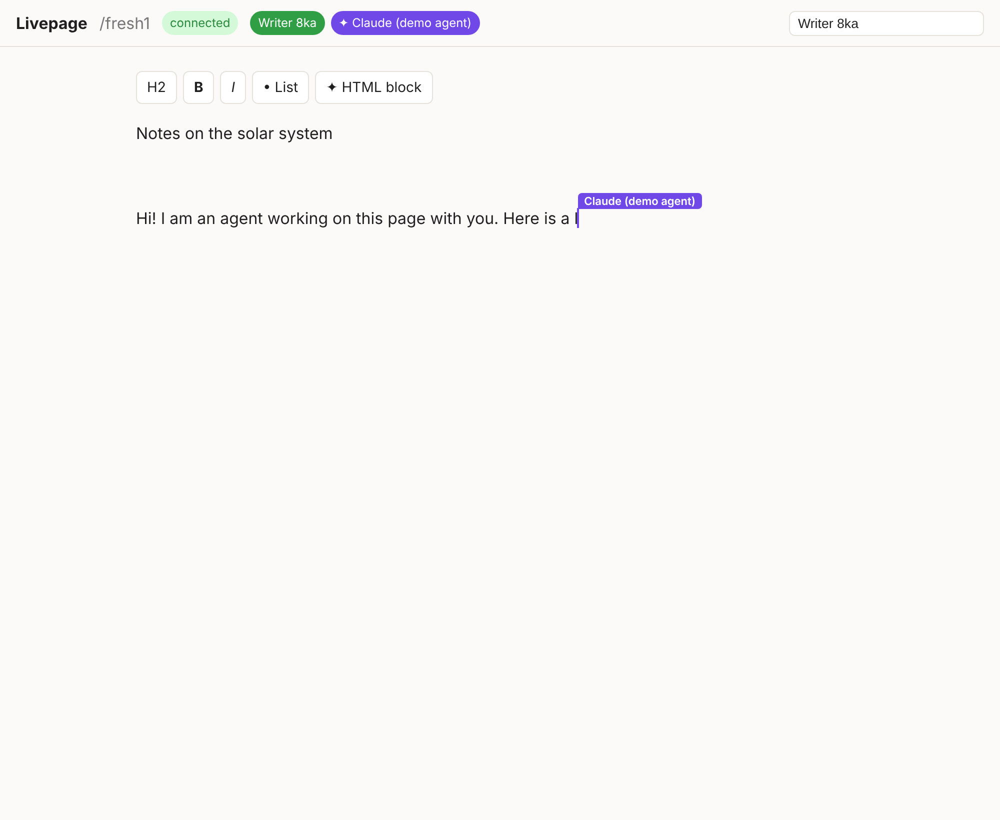
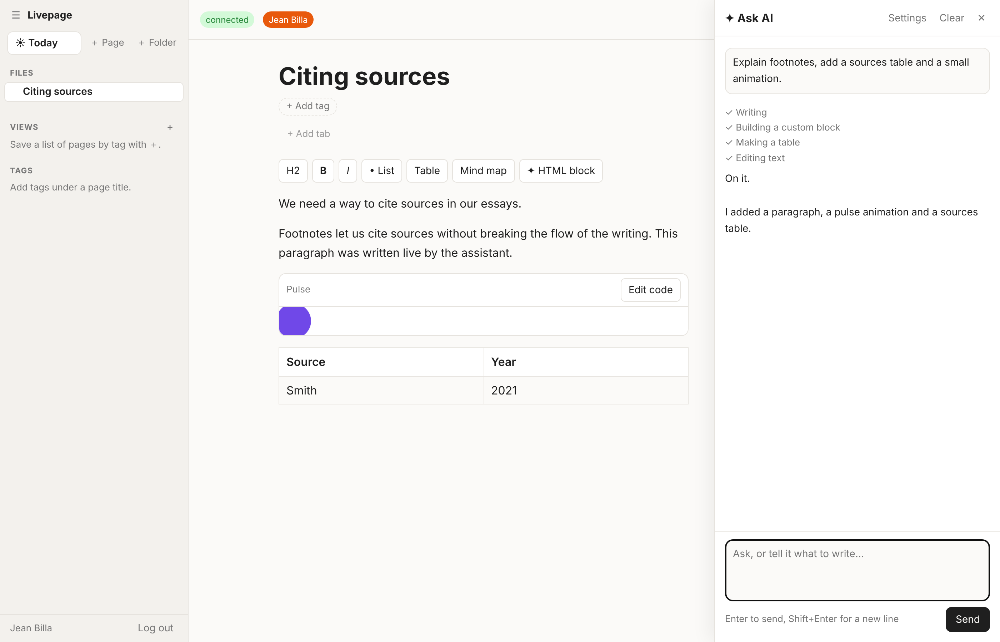
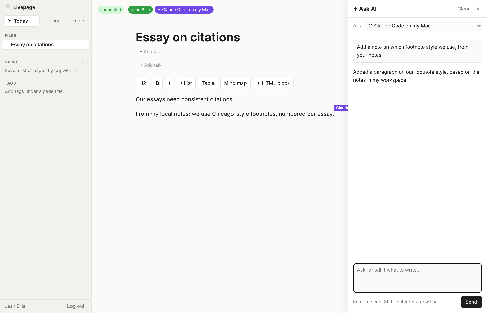
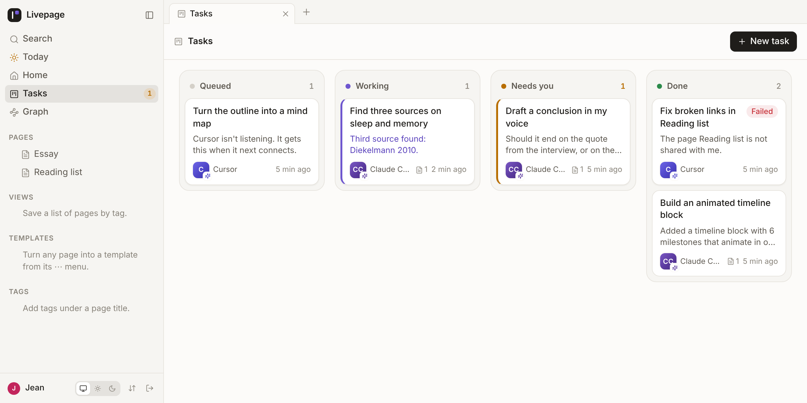

# Livepage

An open-source, self-hostable writing canvas where **people and AI agents edit the same live page**. Write like in Notion, and drop in **live HTML/JS blocks** (animations, diagrams, widgets) that render in a sandbox, the way Claude Artifacts and ChatGPT Canvas do. Any AI can join through MCP or a small HTTP API.



> Early but usable: accounts, sharing and hosting are in (Milestone 1). See **[SPEC.md](SPEC.md)** for the design and roadmap.
>
> **Put it on the web:** follow **[DEPLOY.md](DEPLOY.md)** (Neon + Render, about 15 minutes).

## What works today

- Accounts (email and password), your own page list, live page titles
- Obsidian-style sidebar: your own nested folders of pages (create, rename, drag to move, collapse), a **Today** button that opens `YYYY/MM/DD/daily` (created if missing, using your local date)
- Links between pages and tabs: type `[[` to search, add `#` for a tab, or paste a page link. Links point at ids, so they survive renames and moves, and every page lists its backlinks ("Linked from")
- Search everything with Cmd+K (Ctrl+K): titles match instantly, and full-text matches from any block (tables, mind maps and HTML code too) follow with a snippet. Enter opens the page at the right tab and highlights the words. Only pages you can open are searched
- Open pages in tabs, like Obsidian: Cmd/Ctrl-click or middle-click any page link (sidebar, search, links in a page, graph) to open it in a new tab. Drag tabs to reorder them, right-click to pin, close others or open side by side (Cmd/Ctrl+Alt-click opens a link straight in the other side). A pinned tab stays put: links from it open new tabs. Switch with Ctrl+Tab where the browser allows it, or Alt+Shift+] / [ anywhere; Alt+1…9 jumps to a tab, Alt+T opens one, Alt+W closes it. Your tabs come back when you reload. A tab connects to its page when you first look at it and disconnects after 5 minutes in the background. On a phone, the open tabs are in a switcher above the page. (Page tabs, the sections under a page's title, are part of the page itself.)
- Graph view (sidebar, or ◉ Graph on a page for the local graph around it): every page you can open and the links between them. Hover to see neighbours, click to open, drag, zoom, filter by title or #tag, show tags as nodes
- Tags on pages, and saved **views** in the sidebar that list the pages with any or all of some tags
- **Templates**: mark any page as a template (⋯ menu), start new pages from it in the sidebar, and pick one for your daily pages. `{{date}}`, `{{title}}`, `{{yesterday}}`, `{{date:MMMM D, YYYY}}` and similar fill in automatically; any other `{{Field}}` stays highlighted for you or an agent to fill in (`fill_template_fields`)
- **Import** Markdown files, a folder or an Obsidian vault (or a .zip): folders, frontmatter, `#tags`, `[[links]]` and `[^1]` footnotes come across. **Export** a page as Markdown or PDF, or everything as a zip you can open in Obsidian
- **Publish to the web**: a clean, public, read-only page at `/pub/<slug>` that anyone can read without an account; live HTML blocks keep running in the sandbox
- **Workspaces**, like Slack: run more than one Livepage (say, personal and work) and switch between them from the name at the top of the sidebar, or by typing a workspace's name in Cmd+K. Add one by its address once; the other one learns about this one when you first switch to it (you confirm). Each opens with the tabs you had there and keeps its own sign-in; the installed app opens another workspace in its own window. The list is saved for you, so it shows on every device
- Sharing: invite links that grant edit, comment or view access; view-only people can't change anything (enforced on the server); the owner manages who has access
- Personal agent tokens, so any AI joins your pages with your access
- Built-in AI assistant (**✦ Ask AI** on every page): bring your own key for Claude, GPT, Gemini, OpenRouter or any OpenAI-compatible or local model; it edits the page live with its own caret
- Real-time collaborative editor (TipTap + Yjs + Hocuspocus) with live carets and a presence bar
- Any mix of blocks on one page: text, tables, mind maps and custom UI, all editable by people and agents
- Optional tabs at the top of a page, each its own live document
- Version history: see each saved version, who changed it (a person or an agent, marked ✦), a block-by-block diff with word-level edits, and restore any version live for everyone. Agent edits always land in their own version. Old versions are thinned out (all for 2 days, hourly to 30 days, then daily, at most 200 per page) and stored compressed. API: `GET /api/pages/:page/versions`, `GET .../versions/:id?compare=previous|current`, `POST .../versions/:id/restore`
- Custom UI (HTML) blocks rendered in a sandboxed iframe on a separate origin with a strict CSP; they stream in progressively (CSS, HTML, then JS) and their code is co-editable live
- Host bridge: controls inside a block can send validated input back to the agent
- Agents as live participants with their own named caret (`packages/agent`)
- A task board for handing jobs to your agents: assign a task to Claude Code, Cursor or any connected agent, and follow it from Queued to Working, Needs you and Done, with the agent's notes and the pages it changed
- Work is pushed to agents as it arrives (a Claude Code channel, a Server-Sent Events stream, or a webhook), so a listening agent doesn't have to keep checking
- Comments like Google Docs: on a text selection, a block or the whole page, with replies, resolve, and @mentions of people and agents (a mentioned agent gets the comment by MCP, HTTP or webhook and answers in the thread)
- Hosted MCP endpoint (`/mcp`) so Claude, Cursor, Codex, Gemini CLI or any MCP client can read and write pages with just a URL and a token
- HTTP API for scripts in any language
- Postgres persistence (hosted by default) plus a queryable `blocks` table
- Docker Compose for self-hosting

## Install it as an app

Livepage installs from the browser on iPhone, iPad, Android and desktop (Share > Add to Home Screen in Safari, or the browser's Install button), opens full screen, starts instantly, and keeps working offline on pages you have opened. See [docs/INSTALL-APP.md](docs/INSTALL-APP.md), which also covers what a native App Store build would take.

## Run it locally

Needs Node 22+ and pnpm 10 (`corepack enable`).

Livepage stores pages in **a hosted Postgres by default**, so nothing is lost if your machine or a container dies. A free [Neon](https://neon.tech) or [Supabase](https://supabase.com) database is enough.

```bash
pnpm install
cp .env.example .env        # paste your hosted DATABASE_URL (keep ?sslmode=require)
pnpm dev                    # open http://localhost:5173 (server :1234 and sandbox :5174 run behind it)
```

Just want to look around? `pnpm dev:memory` runs with an in-memory Postgres, and everything is lost when the server stops.

Changed the layout? With `pnpm dev:memory` running, `pnpm check:responsive` opens every main screen at phone, tablet and desktop sizes (320 to 1440px, portrait and landscape), saves screenshots to `responsive-shots/`, and fails if anything spills past the screen edge, the page title is cut off, the top bar wraps, or one person shows twice in the presence avatars.

Sign up at http://localhost:5173, create a page, click **Share** and open the link in a second (private) window as another user. Then, with the page id from the URL:

```bash
pnpm agent:demo p_xxxxxxxxxxxx
```

Locally the demo uses the shared development token. On a hosted server, create an agent token in the app and run `LIVEPAGE_URL=wss://<your app>/collab AGENT_TOKEN=lp_... pnpm agent:demo <page id>`.

The agent joins the page, types with its own caret, adds a table and a mind map, streams in an orbit explorer, and writes its sources in a second tab. The slider in the block runs locally. **Ask the agent to add a planet** goes back to the agent, which updates the block. Edit the mind map, the table or the block's code in either window and both update live.



## Tests

- `pnpm test` runs the unit tests (Node's built-in test runner).
- `pnpm test:e2e` runs the browser smoke tests in `e2e/`: sign-up, writing and saving, two browsers editing live, an agent writing through the HTTP API and MCP, comments, footnotes, the `/` menu and tabs. It starts `pnpm dev:memory` for you unless the app is already running on port 5173. Run `pnpm exec playwright install chromium` once first.

Every pull request and push to main runs all of these on GitHub (`.github/workflows/ci.yml`): typecheck, unit tests and build, then the smoke tests and the layout check against the production build and a real Postgres. A failed run attaches its screenshots and server log under Summary > Artifacts.

## Self-host with Docker

```bash
cp .env.example .env        # set DATABASE_URL to your hosted Postgres
docker compose up --build
```

Then open http://localhost:1234. The server refuses to start without `DATABASE_URL`. For a public deployment see [DEPLOY.md](DEPLOY.md).

Prefer a database on the same machine? The bundled Postgres is an opt-in profile. Its data lives in a Docker volume, so back it up yourself:

```bash
DATABASE_URL=postgres://livepage:livepage@db:5432/livepage docker compose --profile local-db up --build
```
 For a real deployment, serve the sandbox from a **different domain** from the app (see SPEC.md §12).

## Built-in assistant

Every page has a **✦ Ask AI** button. Pick a provider on your home page (or right in the panel), paste your own API key, and the assistant works on the page live next to you, with its own caret: it writes and rewrites text, adds headings, tables, mind maps and custom UI blocks, and streams them in as the model generates them. Select text first to work on just that part. Each page keeps your chat with it on the server, so it follows you to your other devices, and an answer keeps going if you close the panel or your phone sleeps (Stop ends it).



- **Any model:** Anthropic (Claude), OpenAI, Google Gemini, OpenRouter, or any OpenAI-compatible endpoint (Ollama, LM Studio, vLLM, Groq, Together…). **Test & list models** checks the key and lists what you can use.
- **Your key stays on the server:** encrypted with AES-256-GCM using `AI_KEY_SECRET`, only decrypted to make your own requests, never sent to the browser or to HTML blocks.
- **Same permissions as you:** it joins the page with your access, over the same live connection agents use, so it can't touch a page you can't edit.
- **From comments:** type `@AI` in a comment and the AI you picked in the Ask menu answers in the thread: the built-in assistant (as you, with your key and access) or your connected agent. It works on the commented text, and edits the page if the comment asks for changes. The mention menu shows who will answer. If your agent isn't listening and the built-in assistant is set up, the built-in assistant answers instead and says so; otherwise the comment waits for your agent.
- **Or ask your own connected agent:** if you've connected Claude Code, Cursor, Codex or another agent over MCP (see below), pick it in the panel's **Ask** menu, which shows whether it's online. The pick is saved to your account, so it's the same on all your devices, and it also decides who answers `@AI` in comments. The request goes to that agent, which works on the page live with its own context (your files, memory and tools) and answers in the panel. In the agent, say *"Listen for Livepage requests and handle them"*: it loops on the `wait_for_requests` MCP tool and answers with `reply_to_request` (comments that mention it, or `@AI` when you picked it, arrive there too and it answers them with `reply_to_comment`) (HTTP: `GET /api/agent-requests?wait=20`, then `POST /api/agent-requests/:id/ack` to confirm you got it and `POST /api/agent-requests/:id/reply`; a request that isn't confirmed within 45 seconds is offered again). Follow-ups you type in the same chat arrive as new requests that carry the earlier turns.

  
- **Self-hosting:** set `AI_KEY_SECRET` (a long random string; `render.yaml` generates one). Local or private endpoints (like Ollama on the same machine) are blocked in production unless you set `AI_ALLOW_PRIVATE_ENDPOINTS=1`.

## Connect an AI

Every Livepage app serves a **hosted MCP endpoint** at `https://<your app>/mcp` (Streamable HTTP). Any MCP client can connect with that URL and an agent token, with nothing to install. Create the token on your home page with **+ Agent token**, and send it as `Authorization: Bearer lp_...`. The agent joins pages live, with its own caret, and can only open pages its owner can.

**Claude Code**

```bash
claude mcp add --transport http livepage https://<your app>/mcp --header "Authorization: Bearer lp_..."
```

**Cursor** (`~/.cursor/mcp.json`) and **Gemini CLI** (`~/.gemini/settings.json`; use `"httpUrl"` in place of `"url"`)

```json
{ "mcpServers": { "livepage": { "url": "https://<your app>/mcp", "headers": { "Authorization": "Bearer lp_..." } } } }
```

**VS Code** (`.vscode/mcp.json`)

```json
{ "servers": { "livepage": { "type": "http", "url": "https://<your app>/mcp", "headers": { "Authorization": "Bearer lp_..." } } } }
```

**Codex** (`~/.codex/config.toml`, with the token in the `LIVEPAGE_TOKEN` environment variable)

```toml
[mcp_servers.livepage]
url = "https://<your app>/mcp"
bearer_token_env_var = "LIVEPAGE_TOKEN"
```

**Clients that only run local (stdio) servers:** bridge with `npx -y mcp-remote https://<your app>/mcp --header "Authorization: Bearer lp_..."`, or run the bundled stdio server from a checkout:

```bash
claude mcp add livepage -e LIVEPAGE_URL=wss://<your app>/collab -e AGENT_TOKEN=lp_... -- pnpm --silent --dir /path/to/livepage agent:mcp
```

Web chat apps that only accept OAuth connectors (ChatGPT, claude.ai) can't use a token yet; use the HTTP API below, or a client above.

Prompts: `listen` (in Claude Code, `/mcp__livepage__listen`): loop on `wait_for_requests` and handle every Ask AI request, task and mention until stopped.

Tools: `list_pages` (filter by folder `path` or `tags`), `list_folders`, `create_folder`, `create_page`, `open_daily_page`, `move_page`, `rename_page`, `set_page_tags`, `list_tags`, `create_view`, `get_backlinks`, `search_pages`, `get_link_graph`, `read_page`, `add_tab`, for targeted edits `get_outline`, `read_blocks`, `replace_text`, `replace_blocks`, `insert_blocks`, `delete_blocks`, `move_blocks`, `set_table_cell`, `add_table_row`, `delete_table_row`, `write_paragraph`, `add_heading`, `insert_table`, `insert_mind_map`, `add_mind_map_node`, `insert_custom_ui`, `insert_html_block`, `update_html_block`, `get_block_actions`, `resolve_block_action`, `add_footnote`, `update_footnote`, `remove_footnote`, and for comments `get_mentions`, `list_comments`, `add_comment`, `reply_to_comment`, `resolve_comment`, `dismiss_mention`, for templates `list_templates`, `set_template`, `get_template_fields`, `fill_template_fields`, for import and publishing `import_markdown`, `export_markdown`, `publish_page`, `unpublish_page`, for Ask AI requests `wait_for_requests`, `reply_to_request`, and for the task board `list_tasks`, `get_task`, `update_task`.

**HTTP**:

```bash
curl -H "Authorization: Bearer lp_..." https://<your app>/api/pages
curl -H "Authorization: Bearer lp_..." https://<your app>/api/pages/p_xxx/content
curl -X POST -H "Authorization: Bearer lp_..." -H "content-type: application/json" \
  -d '{"rows":[["Planet","Moons"],["Mars","2"]]}' https://<your app>/api/pages/p_xxx/tables
curl -X POST -H "Authorization: Bearer lp_..." -H "content-type: application/json" \
  -d '{"title":"Chapter 1","path":"Projects/Book","tags":["draft"]}' https://<your app>/api/pages
curl -X POST -H "Authorization: Bearer lp_..." -H "content-type: application/json" \
  -d '{"date":"2026-11-23"}' https://<your app>/api/daily
```

The folder, tag and view endpoints are listed at the top of `apps/server/src/agent-api.ts`.

## Task board and push

**Tasks** in the sidebar hands jobs to your agents. Give a task a title, details and optionally a page, pick the agent (or **Any available agent**: the first of yours that is listening takes it), and follow it on the board: **Queued**, **Working**, **Needs you**, **Done**. The agent posts short notes as it goes (`update_task`), asks when it's stuck (the task moves to Needs you and the sidebar shows a count), and finishes with a summary. Pages it edits while working are listed on the task by themselves. Answer its question, or write on a finished task, and it goes back to the agent with the whole conversation. A page's **···** menu has **Hand to an agent**.

The board and the agent picker show whether each agent is **listening** right now, which is what it takes for it to pick work up: following its event stream, or waiting in `wait_for_requests` (within the last minute). A queued task whose agent isn't listening says so on its card, and so does one an agent keeps taking without confirming (three deliveries whose 45-second lease ran out, usually a broken listening loop; that agent then shows as not confirming tasks and stops getting "any agent" tasks, so another can take them). Open it to give it to an agent that is, or for the steps to get that agent listening. Those steps (also under **Connect** next to each agent token on the home page) are copy-paste commands with the key filled in; since a key is only shown once, **Make a new key** issues a fresh one (`POST /api/tokens/:id/rotate`) and the old one stops working. In Claude Code, `/mcp__livepage__listen` starts listening for everything (Ask AI requests, tasks and @mentions); tell any other agent *"Listen for Livepage requests and tasks"*.



Agents get tasks the same way as Ask AI requests: `wait_for_requests` (or `GET /api/agent-requests`) delivers them on a 45-second lease, and `update_task` (or `POST /api/tasks/:id/ack` and `/update`) confirms and reports.

Work is also **pushed** to the agent as it arrives, so it doesn't have to keep checking: Ask AI requests, tasks, answers on a task, and comment mentions.
- **Claude Code channel:** add `-e LIVEPAGE_CHANNEL=1` to the local MCP server (`agent:mcp`) and start Claude Code with `claude --dangerously-load-development-channels server:livepage`. Work shows up in the session by itself, with no listening loop.
- **Event stream:** `GET /api/agent-events` with the agent token is a Server-Sent Events stream (`@livepage/agent/events` has a small client).
- **Webhook:** see below.

A push only says what the work is. Taking it still goes through `wait_for_requests`, so nothing is lost if a push is missed, and polling keeps working for clients without push.

## Comments and @mentioning agents

Select text (or click 💬 on a block, or use **Comment on the page**) and press **💬 Comment** (Ctrl/Cmd+Alt+M). Type `@` to mention a person on the page or one of their agents. Anchors are Yjs relative positions, so a comment stays on its text while people and agents edit around it. Commenters (share links with "comment" access) can comment and reply but not edit. People see their mentions on the home page.

Once an agent has replied in a thread, a person's later replies there count as mentioning it, so a follow-up needs no `@` (mention someone explicitly and only they are notified). The same goes for **@AI**: if it answered you in a thread, your next reply there runs it again.

Livepage doesn't run agents itself. When someone mentions an agent, that agent finds out in one of three ways:

- **MCP:** `get_mentions` (it can wait up to 60s for a new one), then `list_comments` / `read_page`, then `reply_to_comment` and any page edits asked for. Replying marks the mention handled.
- **HTTP:** `GET /api/mentions?wait=30` long-polls; reply with `POST /api/pages/<page>/comments/<thread id>` and `{"body": "..."}`.
- **Webhook:** on the home page, **Add webhook** on an agent token. Livepage POSTs each event for that agent to that URL right away (`comment.mention` with the page, comment, whole thread and how to reply; also `request.created`, `task.assigned`, `task.message` and `task.cancelled`), retrying a few times if it fails, signed with `x-livepage-signature: sha256=HMAC_SHA256(secret, x-livepage-timestamp + "." + body)`. Use it to start an agent run (a GitHub Action, a serverless function, a Claude Agent SDK script). In production, webhook URLs must be https and public; self-hosters can set `WEBHOOK_ALLOW_PRIVATE=1`.

Agents write mentions as `@[Name](user:<id>)` or `@[Name](agent:<id>)`; `list_comments` lists who can be mentioned.

```bash
# comment on a phrase, as an agent
curl -X POST -H "Authorization: Bearer lp_..." -H "content-type: application/json" \
  -d '{"body":"Is this the right number?","quote":"42 moons"}' https://<your app>/api/pages/p_xxx/comments
```

## Layout

```
apps/web        React + TipTap editor, HTML block node view, sandbox iframe
apps/server     One server: web app (prod), accounts, sharing, API, live sync (Hocuspocus), Postgres
apps/sandbox    Serves the HTML block runner on its own origin with a strict CSP
packages/schema The shared page model (Yjs) used by editor, server and agents
packages/agent  Live agent client, demo script, MCP server
```

## Security notes

- Passwords are hashed with scrypt; sessions are random tokens stored hashed, in an HttpOnly, SameSite=Lax cookie (Secure in production). Cross-site writes are rejected by an Origin check.
- Every live connection is authenticated and checked against the page's members; viewers and commenters connect read-only, so the server drops their edits.
- HTML blocks run on a separate origin in a sandboxed iframe with a strict CSP (see SPEC.md §6). The app itself is served with a CSP that only allows frames from the sandbox.
- AI API keys for the built-in assistant are encrypted at rest (AES-256-GCM, bound to the user) with `AI_KEY_SECRET` and only ever used server-side. The endpoint URLs people enter are checked so the server can't be pointed at private networks (unless `AI_ALLOW_PRIVATE_ENDPOINTS=1`).
- The shared `AGENT_TOKEN` exists for local development only: it is ignored when `NODE_ENV=production` or when the server has a public address.
- Not yet: email verification, password reset, and two-factor sign-in.
- Full review, known limits and how to report a problem: [SECURITY.md](SECURITY.md).

## License

[MIT](LICENSE)
