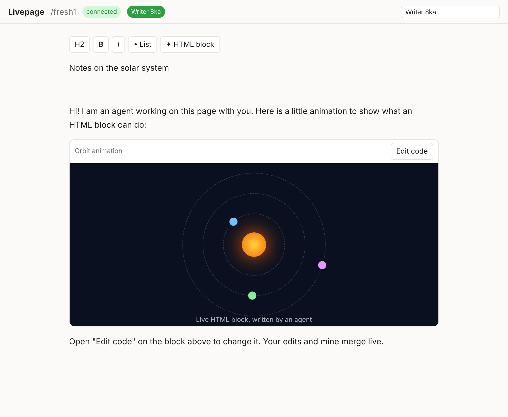

# Livepage

An open-source, self-hostable writing canvas where **people and AI agents edit the same live page**. Write like in Notion, and drop in **live HTML/JS blocks** (animations, diagrams, widgets) that render in a sandbox, the way Claude Artifacts and ChatGPT Canvas do. Any AI can join through MCP or a small HTTP API.



> Early scaffold (Milestone 0). See **[SPEC.md](SPEC.md)** for the full design and roadmap.

## What works today

- Real-time collaborative editor (TipTap + Yjs + Hocuspocus) with live carets and a presence bar
- HTML blocks rendered in a sandboxed iframe on a separate origin with a strict CSP; their code is co-editable live
- Agents as live participants with their own named caret (`packages/agent`)
- MCP server so Claude, ChatGPT or any MCP client can read and write pages
- HTTP API for scripts in any language
- Postgres persistence (hosted by default) plus a queryable `blocks` table
- Docker Compose for self-hosting

## Run it locally

Needs Node 22+ and pnpm 10 (`corepack enable`).

Livepage stores pages in **a hosted Postgres by default**, so nothing is lost if your machine or a container dies. A free [Neon](https://neon.tech) or [Supabase](https://supabase.com) database is enough.

```bash
pnpm install
cp .env.example .env        # paste your hosted DATABASE_URL (keep ?sslmode=require)
pnpm dev                    # web :5173, collab server :1234, sandbox :5174
```

Just want to look around? `pnpm dev:memory` runs without a database, and pages are lost when the server stops.

Open http://localhost:5173/?page=demo in **two browser windows**, then in a third terminal:

```bash
pnpm agent:demo demo
```

The agent joins the page, types a paragraph with its own caret, and streams in an animated HTML block. Click **Edit code** on the block in either window and edit it: both windows update live.


## Self-host with Docker

```bash
cp .env.example .env        # set DATABASE_URL to your hosted Postgres
docker compose up --build
```

Then open http://localhost:5173. The server refuses to start without `DATABASE_URL`.

Prefer a database on the same machine? The bundled Postgres is an opt-in profile. Its data lives in a Docker volume, so back it up yourself:

```bash
DATABASE_URL=postgres://livepage:livepage@db:5432/livepage docker compose --profile local-db up --build
```
 For a real deployment, serve the sandbox from a **different domain** from the app (see SPEC.md §12).

## Connect an AI

**MCP** (Claude Code example):

```bash
claude mcp add livepage -- pnpm --dir /path/to/livepage agent:mcp
```

Tools: `read_page`, `write_paragraph`, `add_heading`, `insert_html_block`, `update_html_block`. Set `LIVEPAGE_URL`, `AGENT_TOKEN` and `LIVEPAGE_AGENT_NAME` in the environment if needed.

**HTTP**:

```bash
curl -H "Authorization: Bearer dev-agent-token" localhost:1234/api/pages/demo
curl -X POST -H "Authorization: Bearer dev-agent-token" -H "content-type: application/json" \
  -d '{"title":"Hello","code":"<h1 style=\"color:tomato\">Hi</h1>"}' \
  localhost:1234/api/pages/demo/html-blocks
```

## Layout

```
apps/web        React + TipTap editor, HTML block node view, sandbox iframe
apps/server     Hocuspocus collab server, Postgres storage, agent HTTP API
apps/sandbox    Serves the HTML block runner on its own origin with a strict CSP
packages/schema The shared page model (Yjs) used by editor, server and agents
packages/agent  Live agent client, demo script, MCP server
```

## Security note

The current auth is a placeholder: one shared `AGENT_TOKEN`, everyone else is a guest. Don't expose this to the internet yet. Accounts and permissions are Milestone 1.
